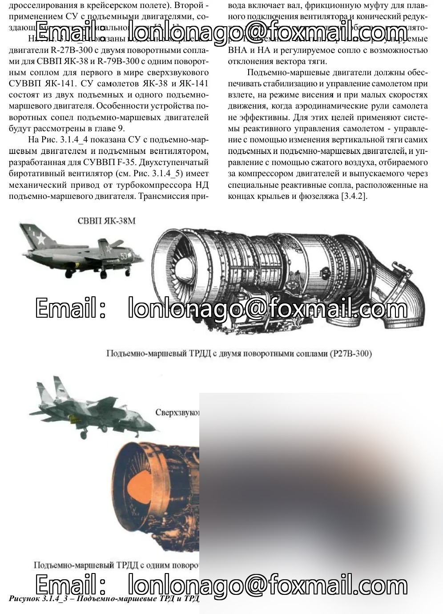
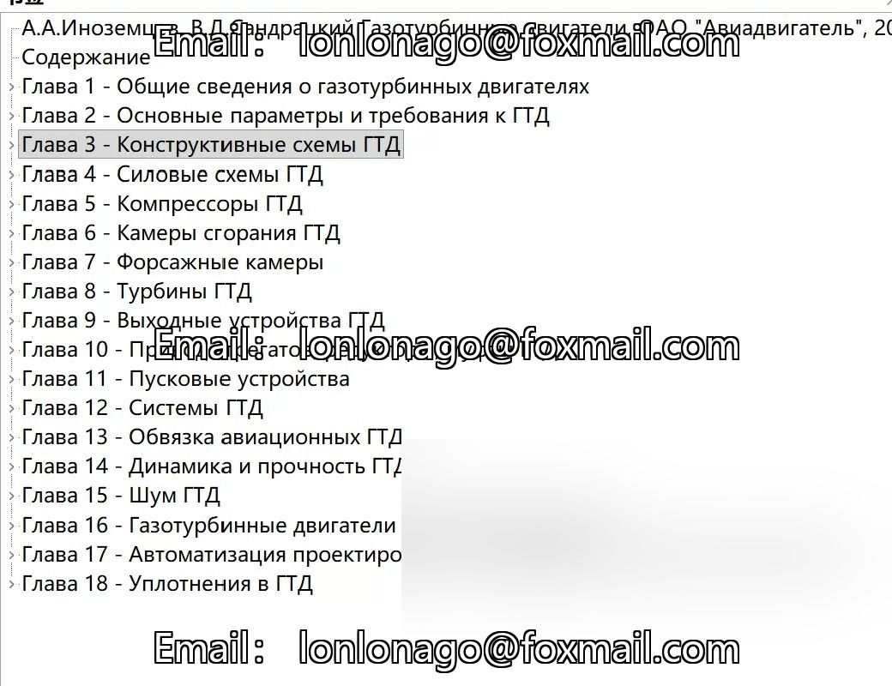
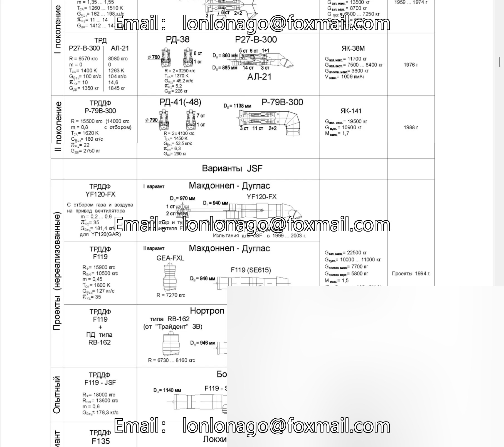
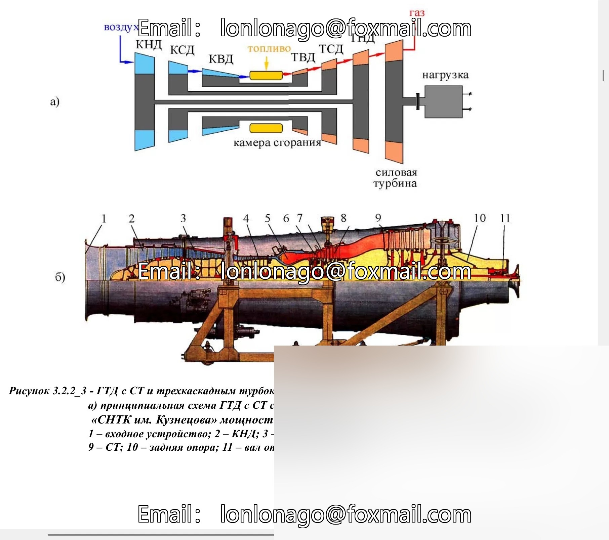
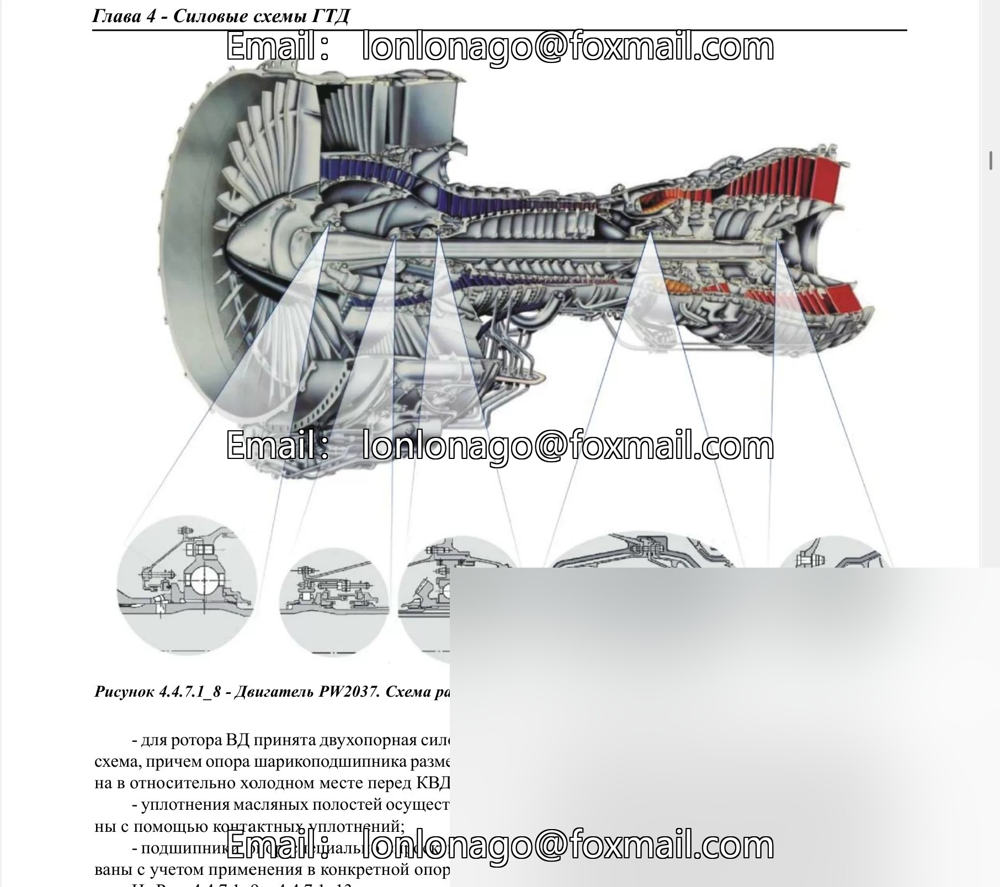

# 《Gas Turbine Engine》A.A. Inozemtsev, V.L. San

## Body

“Gas Turbine Engine” by A.A. Inozhev, V.L. Sandrocik, produced by the Russian company OAO "Avtokhimic"? (or "Aviation Engine" Corporation), which centers on technical knowledge of gas turbine engines (GTD).
file: more than 1,100 pages
Table of contents organized with the concept "from basics to subdivisions, from overall to parts", with each chapter focusing on knowledge modules at different levels, and following logic as:

Basic cognition layer (chapter 1-2):
Chapter 1 introduces general knowledge of gas turbine engines (General knowledge); Chapter 2 clarifies its core parameters and design requirements (Core parameters and requirements).

Core structural layer (Chapter 3 - 10):
Centered around the engine's "structural scheme → power scheme → key functional components → output/transmission components", covering core technical points such as structural design (Chapter 3), power scheme (Chapter 4), compressor (Chapter 5), combustion chamber (Chapter 6), afterburner (Chapter 7), turbine (Chapter 8), output device (Chapter 9), and transmission/speed reducer/universal joint (Chapter 10).

System and Engineering Application Layer (Chapters 11 - 18):
Chapters 11 - 12 cover the startup system, full system (Launch Systems, Power System); Chapters 13 - 15 extend to system adaptation, dynamics and durability, noise control (Aircraft Systems, Dynamics and Stability, Noise); Chapters 16 - 18 expand to power output applications, design automation and full lifecycle management, sealing technology (Power Drives, Automation... , Sealing).

The content covers technical knowledge of gas turbine engines (ГТД) across layers, including basic cognition, core structure, and system and engineering application.

<!-- AI_ENRICHED -->

## Images

## Payment

Here is a pay link on Stripe ( https://buy.stripe.com/3cs8yP7sY87d0vu9AB ). Please contact me lonlonago@foxmail.com after funding $89, and I will send you a complete data files , thank you!

